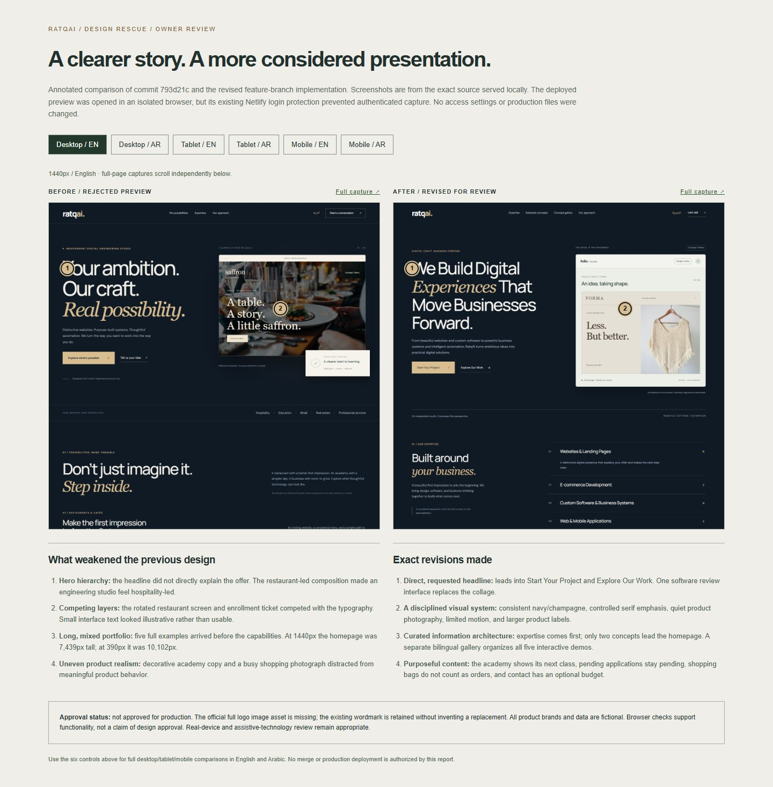

# RatqAI V2 — visual audit and revision record

The owner rejected the composition and organization of commit `793d21c`. The revision prioritizes a clear agency narrative, fewer competing concepts, readable product interfaces, and a consistent navy/champagne editorial system. It is submitted for review, not marked visually approved.

## Before coding

Read the latest owner review on PR #1 and inspected the source. Opened the deployed preview in an isolated Chrome browser. Its existing Netlify authentication gate prevented authenticated capture, so exact-source local screenshots were captured at 1440px, 768px and 390px in English and Arabic. All lazy images were decoded before full-page capture. This limitation is explicit; these are not claimed to be authenticated hosted screenshots.

## Findings and exact responses

1. **Hero did not explain the offer directly.** The restaurant screen plus floating enrollment ticket made hospitality appear dominant. Replaced both with the requested headline, Start Your Project / Explore Our Work CTAs, and one software design-review interface. Retained the original palette and existing wordmark pending the official asset.
2. **Hierarchy was reversed.** Five concept sections preceded the capabilities. Moved a compact expertise experience immediately after the hero, using six native accessible disclosures rather than six generic cards.
3. **Page length diluted the work.** Reduced the homepage to two leading concepts, with a separate filtered gallery for all five. The homepage has fewer style changes, consistent case captions, and tighter transitions between sections.
4. **Product details looked miniature or decorative.** Enlarged the academy table, metrics and labels; replaced its aspirational photo note with the next actual sample class. The restaurant now reads as a complete website hero with coherent navigation and a menu/reservation path. Gallery miniatures are inert and explicitly open into full-size interactive concepts.
5. **Retail photography and state were inconsistent.** Replaced the busy shopping photograph with neutral knitwear and optimized all images. Shopping bag actions no longer count as orders; pending applications no longer count as active students.
6. **Contact needed a serious brief.** Added optional budget and kept name, email, optional business, project type and description. The form clearly prepares a draft rather than showing a false submission success.

## Full-page dimensions (same capture conditions)

| View            |   Before |   After |
| --------------- | -------: | ------: |
| Desktop 1440 EN |  7,439px | 5,177px |
| Tablet 768 EN   |  7,561px | 4,900px |
| Mobile 390 EN   | 10,102px | 6,164px |
| Desktop 1440 AR |  7,383px | 5,138px |
| Tablet 768 AR   |  7,348px | 4,841px |
| Mobile 390 AR   |  9,686px | 6,075px |

These are page-layout measurements, not claimed business outcomes. A separate interactive comparison artifact supplies all six before/after pairs, plus gallery captures. Normal-motion mobile hero/contact and Arabic tablet captures were also visually reviewed. The after page has less density and a clearer reading order; approval remains the owner's decision.

## Known limitations

- Exact official full logo asset remains missing; owner input required. No new logo approximation is introduced.
- Netlify preview remains behind its existing authentication requirement. Local browser visual and interaction review is verified; hosted authenticated browser review is not claimed.
- Photos and business data are illustrative. No real submissions, purchases, clients, results or testimonials are implied.
- Real-device and assistive-technology testing remains appropriate before approving production.

Only `feature/ratqai-v2-phase-one` is authorized. Keep PR #1 open and unmerged. Do not deploy to production.
